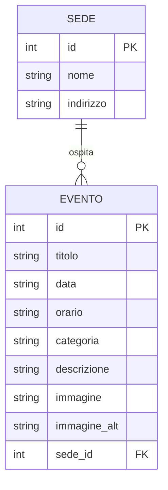

# Scheda dati

## Entità e campi

### Evento

| Campo | Tipo | Esempio |
|---|---|---|
| `id` | numero intero | `1` |
| `titolo` | stringa | `"Lettere in movimento"` |
| `data` | stringa (formato `AAAA-MM-GG`) | `"2026-06-12"` |
| `orario` | stringa (formato `HH:MM`) | `"10:00"` |
| `categoria` | stringa | `"Incontro"` |
| `descrizione` | stringa | `"Come cambia un messaggio quando cambiano le lettere?"` |
| `immagine` | stringa (percorso del file) | `"assets/lettere-in-movimento.svg"` |
| `immagine_alt` | stringa | `"Lettere geometriche disposte su una griglia"` |
| `sede_id` | numero intero | `1` |

### Sede

| Campo | Tipo | Esempio |
|---|---|---|
| `id` | numero intero | `1` |
| `nome` | stringa | `"Officina Nord — Sede centrale"` |
| `indirizzo` | stringa | `"Corso Duca degli Abruzzi 24, Torino"` |

## Chiavi e relazione

`Evento.id` e `Sede.id` sono le chiavi primarie: sono numeriche, univoche all'interno della rispettiva entità e stabili. Una sede può ospitare più eventi; ogni evento si svolge in una sede. `Evento.sede_id` fa riferimento a `Sede.id`.

## Quantità

Il dataset completo comprende sei eventi e tre sedi.

## Aggiornamento e pubblicazione

Chi cura il sito aggiorna gli eventi e le sedi nel foglio Google pubblicato sul web, mantenendo gli ID e i riferimenti tra gli eventi e le sedi. La pagina Programma legge le schede `eventi` e `sedi` dai rispettivi indirizzi CSV pubblicati; i file JSON e CSV nella repository restano copie di riferimento e non sono usati dalla pagina.

| Entità | Scheda | Indirizzo CSV pubblicato |
|---|---|---|
| Evento | `eventi` | `https://docs.google.com/spreadsheets/d/e/2PACX-1vTT7mjPCODsu9JvUBCJG2lm_aeAbIKtadAxZ0RzoVdmg4L4RnIanlsmNeaxy-eChpmn7EI8itrv8o7y/pub?gid=385698909&single=true&output=csv` |
| Sede | `sedi` | `https://docs.google.com/spreadsheets/d/e/2PACX-1vTT7mjPCODsu9JvUBCJG2lm_aeAbIKtadAxZ0RzoVdmg4L4RnIanlsmNeaxy-eChpmn7EI8itrv8o7y/pub?gid=954334914&single=true&output=csv` |
| Notizia | `notizie` | `https://docs.google.com/spreadsheets/d/e/2PACX-1vTT7mjPCODsu9JvUBCJG2lm_aeAbIKtadAxZ0RzoVdmg4L4RnIanlsmNeaxy-eChpmn7EI8itrv8o7y/pub?gid=317082574&single=true&output=csv` |

La Home legge dalla scheda `notizie` i campi `titolo`, `link` e `data`, e mostra al massimo cinque notizie.

## Contenuto della pagina

La pagina Programma mostra le schede degli eventi con titolo, data, orario, categoria, descrizione e immagine, insieme al nome della sede associata.

## Schema Evento–Sede

